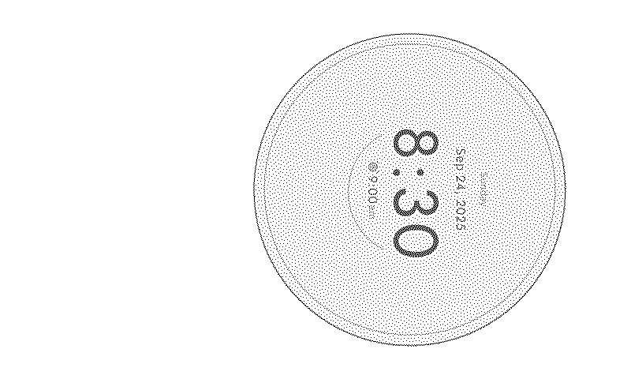

# Inklite

**A Digital Minimalism System Prototype**

## 1. Overview

Inklite reduces information overload while preserving essential smartphone connectivity. It combines Android app monitoring, whitelist intervention, volume-button input, rear-camera hand rotation, BLE and a low-information-density e-paper interface.

**Software implementation: Phase 1–14 complete, version 1.0.0-prototype. Hardware acceptance remains pending.** The repository contains runnable ADB tools, an Android app, a BlueZ peripheral, an actual UI state machine, mock image output and an adapter for the confirmed Waveshare 3.97-inch black/white SPI screen. See [verification](docs/verification.md) and the [Chinese quick start](docs/START_HERE_ZH.md).

**Start here:** [install the included Android APK](apk/Inklite-1.0.0-prototype-debug.apk), follow the [Chinese setup guide](docs/START_HERE_ZH.md), then record results in the [hardware acceptance checklist](docs/hardware-acceptance.md). For phone-only testing, use [this focused guide](docs/phone-testing-ZH.md). The APK is a debug-signed prototype, not a production/store release.

**Validation:** 90 automated tests passed (22 ADB, 28 Android, 40 Pi/UI/display); the Android build, APK signature and Lint checks passed with zero Lint errors. Physical camera, BLE radio and SPI acceptance is still pending.



图为软件模拟渲染效果

## 2. System Architecture

```text
PC → ADB → foreground package → whitelist → force-stop unlisted app → launch Inklite

Android volume key ───────────────→ TAP
Android rear camera → landmarks → temporal rotation → CW / CCW
                                      ↓
                             BLE central / GATT client
                                      ↓ UTF-8 write with response
Pi BlueZ peripheral / GATT server → parser → command handler → UI state
                                                              ↓ immutable snapshot
                                                     serial display worker
                                                         ↙          ↘
                                                    mock PNG     Waveshare driver
                                                                     ↓
                                                             800×480 SPI e-paper
```

## 3. Core Features

- Foreground monitoring, editable whitelist, device selection, timeouts and recovery.
- Rear-camera hand landmarks; custom temporal CW/CCW recognition with noise/cooldown controls.
- Configurable physical volume key → TAP, including when camera permission is denied.
- BLE service discovery, bounded serialized writes, timeouts, revocation handling and explicit reconnect.
- Pi menu navigation, local focus indicator and a monotonic start/pause/resume timer.
- Real 1-bit assets, mock PNG output, slow-display coalescing and manufacturer-driver integration.

## 4. Interaction Model

| Input | Wire command | Pi action |
| --- | --- | --- |
| Configured physical volume key | TAP | Enter selected page; confirm inside it |
| Clockwise hand rotation | CW | Select next page |
| Counter-clockwise hand rotation | CCW | Return from entered page; otherwise select previous |

Normal TAP never comes from vision. Debug APKs include a clearly labelled manual BLE test panel for transport verification; release builds hide that panel.

## 5. App Usage Monitoring

Python polls approximately every 0.75 seconds, prioritizing top-resumed/resumed activity records and using focused-window fallback. Only changes are logged. Unknown/multi-display ambiguity is skipped. Android/OEM dumpsys formats require phone validation. `--usage-stats` prints optional raw usage diagnostics without claiming portable duration statistics.

## 6. Whitelist-based App Restriction

Edit `adb_control/whitelist.json` and restart. Monitor-only is the default. `--enforce` validates the destination activity, rechecks the foreground, runs user-specific `am force-stop`, then launches the configured Inklite activity. Inklite itself is always allowed. Whitelist the actual launcher, dialer, messages, permission screens and other essentials on your phone.

This intervention runs through an authorized ADB computer. An ordinary third-party Android app cannot freely force-stop other apps without elevated/system privileges. Force-stop interrupts app work; it is not a tamper-proof restriction mechanism.

## 7. Physical Volume Button Input

Choose both keys, volume up or volume down in the app. Public `onKeyDown/onKeyUp` callbacks feed an independent handler. Selected events are consumed; key repeats/bounce do not duplicate TAP. Unselected keys and behavior outside Inklite remain normal. Defaults/debounce are in `input/InputConfig.kt`.

## 8. Rear-camera Gesture Recognition

CameraX uses the rear camera by default. CPU MediaPipe Hand Landmarker runs on the camera executor. The camera detects landmarks only; a pure Kotlin trajectory detector classifies rotation. Index tip 8 is measured against averaged palm landmarks 0/5/9/13/17. Image aspect ratio is corrected before angle calculation. Wrapped changes cross ±PI correctly.

Thresholds, radius/path/history checks, consistency, gap/jump resets, cooldown and quiet rearming live in `GestureConfig.kt`. Verify the 21 landmarks first, then enable recognition. Calibrate direction with the inversion checkbox. No pinch or image-classification TAP exists. See [Android tests](docs/android-testing.md).

## 9. BLE Communication

Android is the central/GATT client; Pi is the peripheral/GATT server. Discovery filters the custom service UUID. One write with response is in flight at a time. Commands are accepted only when the link is ready; disconnected/full-queue inputs are dropped. Disconnect and uncertain timeouts clear pending commands, without automatic replay.

An established link is retained while switching to another app; camera analysis stops and inputs remain foreground-only. The link closes on activity destruction, explicit disconnect or connection failure. `singleTask` avoids duplicate Inklite instances after ADB redirects. Android may still terminate background processes; reconnect if the link is lost.

## 10. Raspberry Pi Receiver

`raspberry_pi/ble_receiver.py` exports real BlueZ D-Bus service/characteristic objects and a connectable advertisement. It registers through `GattManager1` and `LEAdvertisingManager1`. Writes are parsed independently from UI logic. Fragmented/prepared/invalid writes are rejected. Startup rollback, shutdown, adapter checks and BlueZ loss are handled.

CW advances through configured pages. CCW returns before selecting the previous page. First TAP enters; subsequent TAP confirms. Confirming Focus toggles a **local indicator**, not the PC whitelist. Confirming Timer starts, pauses or resumes a real monotonic timer; after completion it starts a new interval. Status displays actual received-command and confirmation counts.

## 11. E-paper Output

The selected screen is **Waveshare 3.97-inch black/white SPI e-Paper HAT+, 800×480**, using `waveshare_epd.epd3in97`, as documented in the [official manual](https://www.waveshare.com/wiki/3.97inch_e-Paper_HAT%2B_Manual). The unchanged official driver is bundled under `third_party`, with commit/hash provenance and its original authorization notices.

The adapter calls `init/getbuffer/display/sleep`, validates resolution and packed buffer length, and adds a bounded BUSY wait. It does not rewrite the register/SPI protocol. A serial worker prevents slow refresh from blocking BLE. Intermediate rapid navigation frames may be coalesced to the latest state. Hardware mode uses full refresh; timer output updates by minute, not continuously by second.

Mock mode writes real monochrome PNGs to `work/mock_display` without GPIO, SPI or a physical screen. The four BMP backgrounds are supplied; regenerate with `python -m tools.generate_assets` after changing pages/canvas dimensions.

## 12. Software Stack

Python 3.10+, standard-library ADB control; dbus-next 0.2.3; Pillow 11.3.0; Raspberry Pi OS/BlueZ; manufacturer gpiozero/spidev support. Android uses Kotlin 2.1.20, AGP 8.9.2, Gradle 8.11.1, JDK 17, SDK 35, CameraX 1.4.2, AndroidX Activity 1.10.1 and MediaPipe Tasks Vision 0.10.35. Versions are pinned to the combination compiled and tested.

## 13. Hardware

Windows PC, Android 8+ phone with rear camera/volume keys/BLE, USB data cable, Raspberry Pi 4 and the Waveshare black/white 3.97-inch SPI display with its driver board. No board flashing or cloud service is required. See the [Pi setup and wiring guide](docs/raspberry-pi-setup.md).

## 14. Repository Structure

```text
adb_control/                 ADB client, parser, config, whitelist, monitor
android_app/Inklite/          standard Gradle app: camera/gesture/input/ble
raspberry_pi/                BlueZ objects/server, parser, UI, display, tests
assets/                      home/focus/timer/status 1-bit BMPs
apk/                         verified, ready-to-install Android prototype
third_party/waveshare_3in97/  unchanged official driver + provenance
tools/generate_assets.py     portable asset generation
requirements.txt             ADB has no third-party Python dependency
deployment/                  optional systemd unit
.github/workflows/ci.yml     Python/Android checks for GitHub
README.md / docs/ / licenses/ setup, acceptance and third-party notices
```

## 15. Installation

Open this repository root in VS Code. Install Python 3.10+ and ADB. For PC monitoring:

```powershell
python -m venv .venv
.\.venv\Scripts\python.exe -m unittest discover -s tests -v
```

For local Pi/UI simulation, install its dependencies into that same venv:

```powershell
.\.venv\Scripts\python.exe -m pip install -r raspberry_pi/requirements.txt
.\.venv\Scripts\python.exe -m raspberry_pi.ble_receiver --dry-run
```

## 16. Android Setup

The repository includes a prebuilt APK under `apk/`. With an authorized USB-debugging phone, run from the repository root:

```powershell
adb install -r apk/Inklite-1.0.0-prototype-debug.apk
adb shell am start -n com.inklite.app/.MainActivity
adb logcat -s Inklite
```

To build it yourself, open `android_app/Inklite` in Android Studio with SDK 35/Build Tools 35.0.0/JDK 17. The wrapper and hand model are included. From that directory:

```powershell
.\gradlew.bat :app:assembleDebug :app:testDebugUnitTest :app:lintDebug
adb install -r app/build/outputs/apk/debug/app-debug.apk
adb shell am start -n com.inklite.app/.MainActivity
adb logcat -s Inklite
```

Grant Camera for landmarks. Connect BLE through its button; Android 12+ asks for Nearby Devices. Android 8–11 also need Location permission and enabled Location services for discovery; position data is not collected. Bluetooth enabling uses a system prompt. No Internet permission is requested.

## 17. ADB Setup

Install [official Platform Tools](https://developer.android.com/tools/releases/platform-tools), add their folder to PATH, enable USB debugging and approve the phone's authorization dialog. Run `adb devices -l`. Multiple attached devices require `--serial SERIAL` or private configuration. Personal SDK paths/serials belong in ignored `config.local.json`, never committed. See [Windows testing](docs/windows-testing.md).

## 18. Raspberry Pi Setup

Install BlueZ, Python/venv and the manufacturer GPIO/SPI dependencies, enable SPI, and power the Bluetooth adapter. Use a venv with `--system-site-packages` so the apt-installed GPIO/SPI libraries remain available. Full commands and the 9-pin mapping are in [Pi setup](docs/raspberry-pi-setup.md).

## 19. How to Run

From the repository root, start with these independent checks:

```text
python -m adb_control.app_monitor
python -m raspberry_pi.ble_receiver --dry-run
python -m raspberry_pi.display_controller --mode mock --page timer
```

On Pi, test real BLE with mock output before attaching the screen:

```bash
sudo .venv/bin/python -m raspberry_pi.ble_receiver --display mock
```

Then test the screen alone, stop that process, and run the combined receiver:

```bash
sudo .venv/bin/python -m raspberry_pi.display_controller --mode hardware --page home
sudo .venv/bin/python -m raspberry_pi.ble_receiver --display hardware
```

Once camera/BLE/redirect tests pass and the whitelist is reviewed, enable PC restriction using `python -m adb_control.app_monitor --enforce`. Ctrl+C unregisters BLE and shuts down display resources. Runtime settings are centralized in the ADB/Pi JSON files and Android configuration classes. Relative Pi paths resolve beside its config file.

## 20. Testing

```text
python -m unittest discover -s tests -v
python -m unittest discover -s raspberry_pi/tests -v
python -m raspberry_pi.ble_receiver --dry-run
```

The Pi suite uses actual D-Bus signatures and the real vendor buffer packer, with simulated bus/GPIO access. It tests parsing, registration/rollback, navigation, timer, bitmap output, slow-display coalescing and driver contracts. It does not establish radio or SPI success on physical hardware. See [verification](docs/verification.md), [BLE acceptance](docs/ble-testing.md), [Android acceptance](docs/android-testing.md) and [the final checklist](docs/hardware-acceptance.md).

## 21. BLE Command Protocol

| UTF-8 payload | Bytes (hex) | Meaning |
| --- | --- | --- |
| TAP | 54 41 50 | Confirm / Enter |
| CW | 43 57 | Next / Select |
| CCW | 43 43 57 | Back / Return |

Service UUID: `72fbb2cc-949e-4a4e-9c23-03f50a0798cb`.
Command characteristic UUID: `10fc5a67-f00e-4d52-94c2-673a573b6722`.

Use one characteristic write **with response**; no newline, JSON, fragmentation or prepared write. UUIDs are centralized per platform and cross-checked by tests. An ATT acknowledgement means handler acceptance, not that the e-paper refresh has finished.

## 22. Prototype Limitations

- Physical phone, BLE and SPI acceptance remains to be performed by the hardware owner.
- ADB requires a running authorized PC; OEM foreground records, profiles, essential package names and redirect behavior need local validation. Polling acts after an app opens.
- Gesture reliability depends on lighting, occlusion, inference speed and camera-plane hand rotation. Whole-hand translation with unchanged pose is not rotation about the palm.
- Discovery selects the first matching service: run one intended receiver nearby. This prototype uses unpaired BLE writes; no production authentication/persistence is implemented.
- Android can reclaim background processes. Unknown write outcomes are not retried automatically. A visible BLE connection does not imply display health; verify `[DISPLAY]` output and the actual screen.
- Full e-paper refresh is slower than input. Latest-state coalescing is intentional. Focus state and timer are local to the Pi and reset on restart; ADB intervention remains independent.
- The bundled adapter targets the confirmed black/white 3.97 model, not the four-color `(G)` model. GPIO/SPI wiring and hardware drivers cannot be validated on a Windows mock run.

## 23. Future Work

After hardware acceptance: gesture calibration on the intended phone, manufacturer-supported partial-refresh tuning, persistent UI settings, richer low-density pages, production BLE security, and a release signing/publishing process. These are extensions, not unfinished prototype modules.

## Technical References

[ADB](https://developer.android.com/tools/adb), [MediaPipe Hand Landmarker](https://ai.google.dev/edge/mediapipe/solutions/vision/hand_landmarker/android), [Android Bluetooth permissions](https://developer.android.com/develop/connectivity/bluetooth/bt-permissions), [BlueZ GATT API](https://github.com/bluez/bluez/blob/master/doc/org.bluez.GattCharacteristic.rst), [Waveshare 3.97 manual](https://www.waveshare.com/wiki/3.97inch_e-Paper_HAT%2B_Manual). See [third-party notices](THIRD_PARTY_NOTICES.md).
